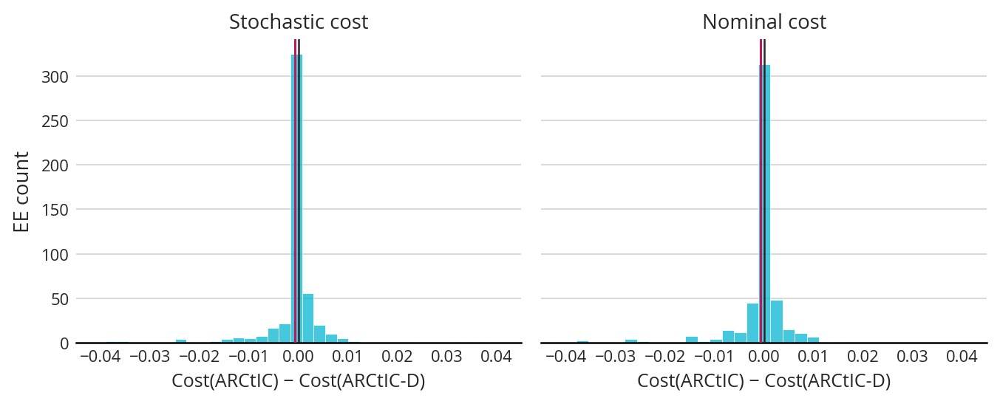
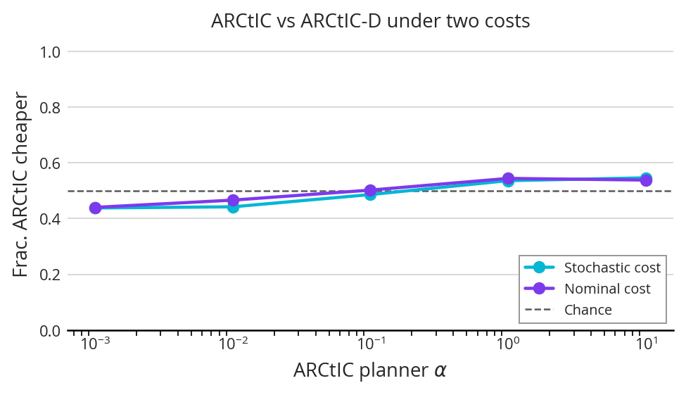
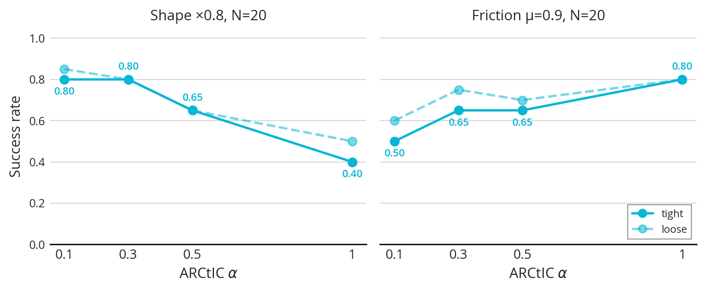
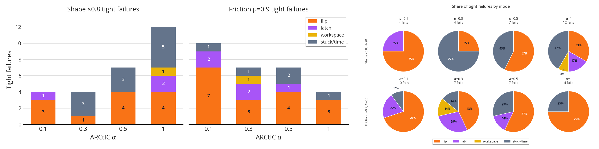
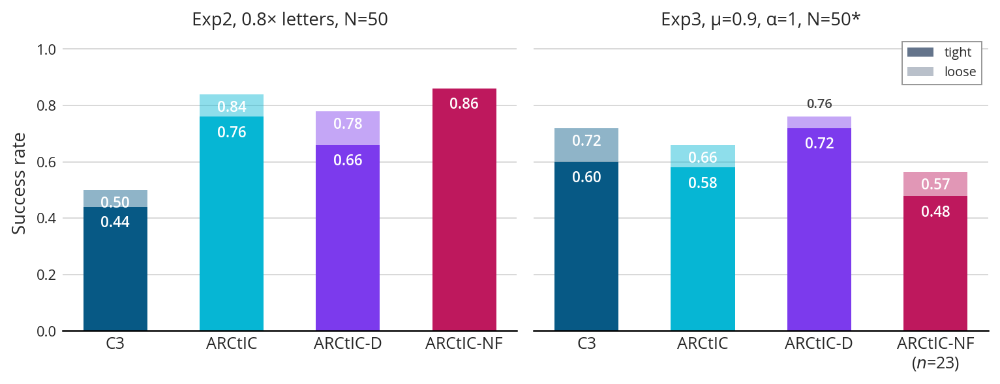
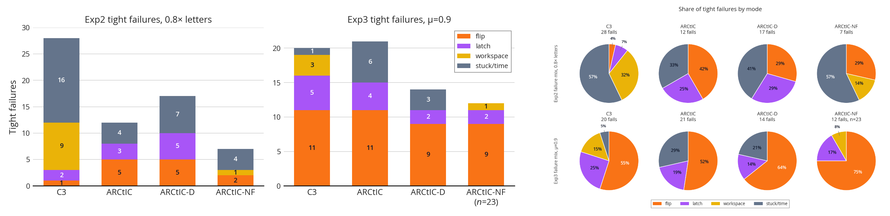
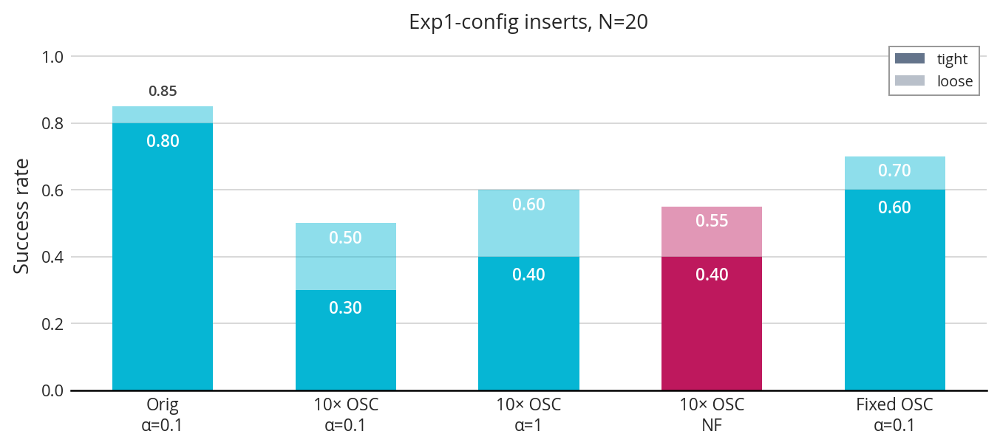
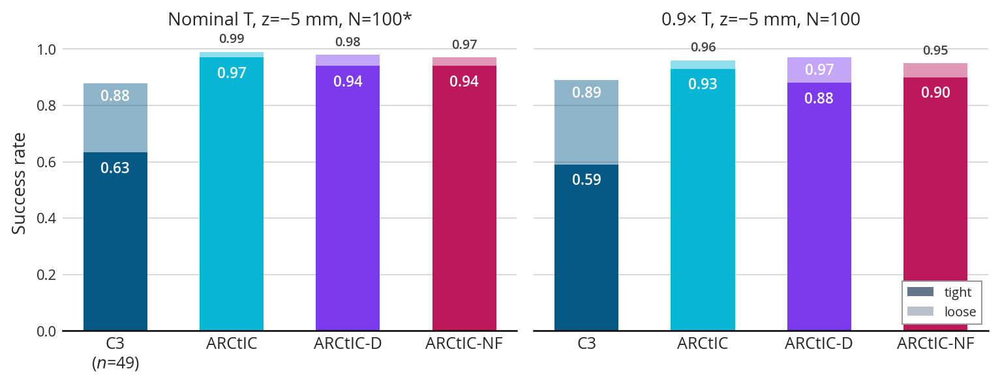
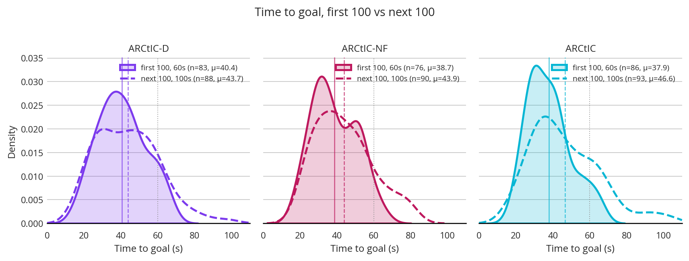

## 1. Last Time

Last time was before IROS and we talked about a couple things. Firstly, we talked about investigating how the uncertainty impacts cost scoring. Secondly, we talked about potentially just running a giant experiment and letting it go. Thirdly, we discussed the lecture that I was going to give (which I have since given). 

The past few weeks, I have been pretty busy with other stuff, so have mostly just had time to run experiments in the background, but the results continue to be undesirable. I also pivoted to testing on push "T", which I detail as well. Finally, I briefly mention a few of the other things that I have going on.

**Quick Note:** *There was an experiment last time where the ARCtIC-D results were invalid, and I said I would finish it. I did and ARCtIC-D performed comparably with ARCtIC (only perhaps slightly worse), and better than ARCtIC-NF.*

## 2. Uncertainty and EE Cost Scoring

The first thing I did was investigate how uncertainty affects the EE sample scoring. The first thing I did was run ADMM with both ARCtIC and ARCtIC-D, then, on a handful of EE samples, score how good each one did according to the ensembled cost and nominal cost. Here are the results:

ARCtIC was slightly better than the determinstic version, but it was *very* slight and I wouldn't think it would be easy to see this propogate to success rates. Next, I have a plot looking at how that effect changes over alpha:

We see a similar story here for $\alpha > 0.1$. In this case, high alpha seems to be worse. The other thing to note is that the two costs correlate extremely strongly (99%), meaning that it probably doesn't matter which cost is used in practice. It is also seen that ARCtIC tends to do more better than ARCtIC-D when evaluated on the randomized cost compared to the deterministic cost. Altogether, if we were relying on the cost with the ensemble to be the one that differentiates the deterministic and uncertainty-aware variants, we may be out of luck—at least with this current setup (and hyperparameters).

**Takeaway:** *While the uncertainty sampling produces a slightly better control plan, it is so slight that it probably won't show up in success rates.*

## 3. The Big Experiment

Next, I decided to run a big experimental pipeline. It had a few stages, but the idea was (1) do a small experiment to select the right $\alpha$; (2) run a big 0.8x shape size push anything experiment; and (3) run a big $\mu = 0.9$ friction experiment. This section goes over the counterintuitive findings, including an effort and potential failure on my part to reproduce findings from the beginning experiments later.

### 3.1 Alpha Results

The first bit of the experiment was to do the small alpha sweep to determine what that parameter should be. Here are the results:

As you can see, the shape and friction experiments seemed to suggest different things. In this experiment, **0.8x shape seems to prefer low alpha, and 0.9 friction seems to prefer high alpha.** This will turn out to be hard to reproduce. 

I have since done a failure analysis of these results: 

The takeaway from this is that high friction is very susceptible to flips for low alpha, whereas with shape, high alpha tends to get stuck or run out of time more.

### 3.2 Shape and Friction Uncertainty

Next I decided to run the shape and friction parts of the pipeline. Because there was a bug in the original launch, I had to change $N=100$ to $N=50$ so it would finish in time. Here are the results from both of those experiments:

This was not good news, because it seemed to contradict the alpha evidence from the first experiment (remember ARCtIC-NF is just ARCtIC with very high alpha). Specifically, **the shape experiment found that high alpha was better, and the friction experiment found that low alpha was better**, and that the deterministic version was best. 

I also have since run failure analysis on these results:

In these results, ARCtIC-NF might've simply got lucky, but at such a low $N$—even though it still takes hours to complete an experiment—it is hard to get out of statistical noise. It also seemed like, with friction, that alpha created more stuck/time failures, which does not bode well. 

I do think the failures specifically have some things that could be cleaned up:

**Note:** *I think I should spend time to reduce the "latch" and "flip" failures, as "stuck/time" seems to be the thing we are after here.*

### 3.3 Repeatability Run

Because these results seemed to contradict each other, I tried a quick reproducability test. My first trial at this accidentally reverted to the original OSC setting, but I was able to get one run off for $\alpha=0.1$, and it was lack luster. Here are the results:

The reproducibility run went from 16/20 tight and 17/20 loose to 12/20 tight and 14/20 loose, which is a drop, but also could just be statistical noise. This all made me very frustrated, so I decided to strip things down and focus on just one object pushing.

## 4. Push "T"

Next I tried to just get some results with single-object pushing to see if I could make sense of what was going on. I decided that since it was much faster, I could kind of do an optuna run, so I did that to come up with a different set of hyperparameters. Interestingly, this predicted a very low $\alpha \approx 0.003$. Then, I ran some trials with a 60 s time limit. Those results looked good, so I decided to do a 100 s time limit (with a lower EE $z$ height to mitigate flips), but in my opinion the results were non-conclusive. Here are the success rates for the 1x and 0.9x versions:

**Note:** *I think C3 performing poorly has to do with the push continuation logic and the fact it is running at a higher Hz.*

All ARCtIC variants had high success rates. ARCtIC seemed to tentatively do best, but I don't know if I would expect that to hold as strongly as $N\to\infty$. The time-to-goal (among successes) was less conclusive. Here is a KDE of the first $N=100$ and second $N=100$ experiments:

The order of which method is fastest flips. In the first experiment, ARCtIC is the fastest (by mean), while in the second, ARCtIC is the slowest. Why would increasing the time budget from 60 to 100 s and making the EE lower enact this change? I don't know.

Overall, I still would like to dig in and try to come up with a *mechanistic understanding* for how including the uncertainty-awareness can help improve this pushing task. I could just send it and run a big experiment, but I have no confidence that that will work unless there is some sort of understanding for what should happen. I think that high-volume push "T" experiments in sim might be okay, and then the real world can be a proof-of-concept that my method handles 4 object pushing in the real world. I also feel like just a regroup for my brain might be worthwhile.

## 5. Other Stuff

The things that have been keeping me busy:

1. Lecture last Tuesday — [annotated slides (also on canvas)](./stochastic_and_robust_control_presentation.pdf)
2. I had my first homework in ESE 618 due last week
3. I had my project proposal for ESE 618 due as well — [PAC-Bayes for IL](./ESE_618_Project_Proposal-2.pdf)

