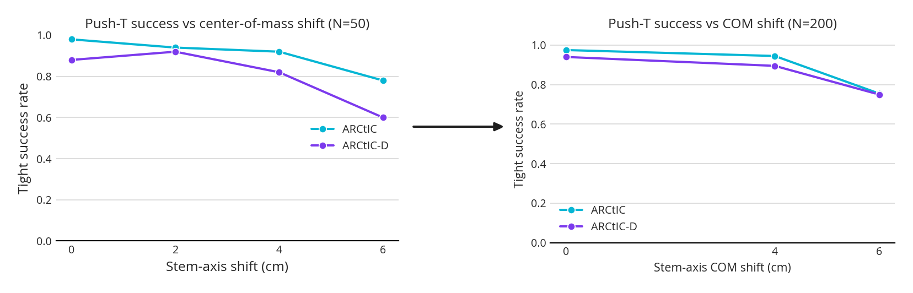
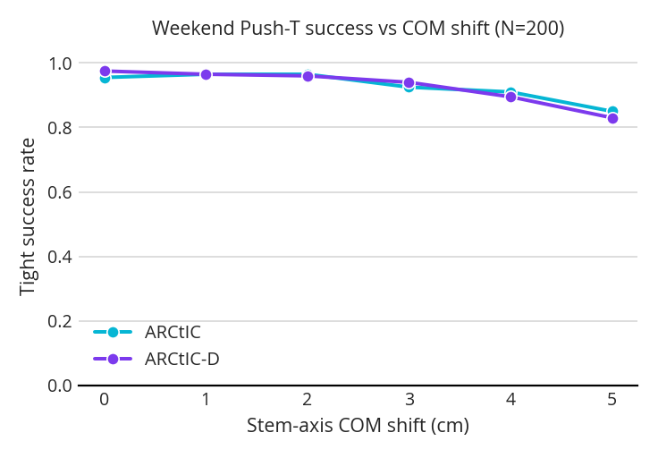
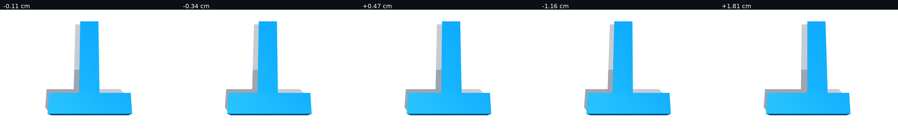
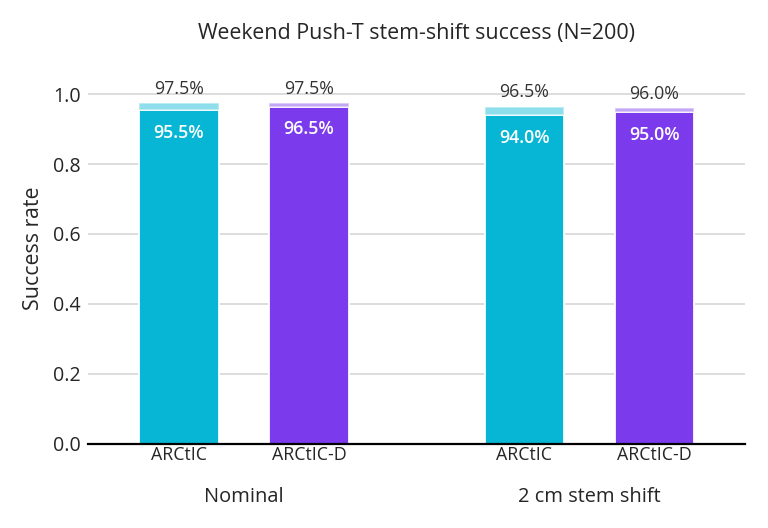
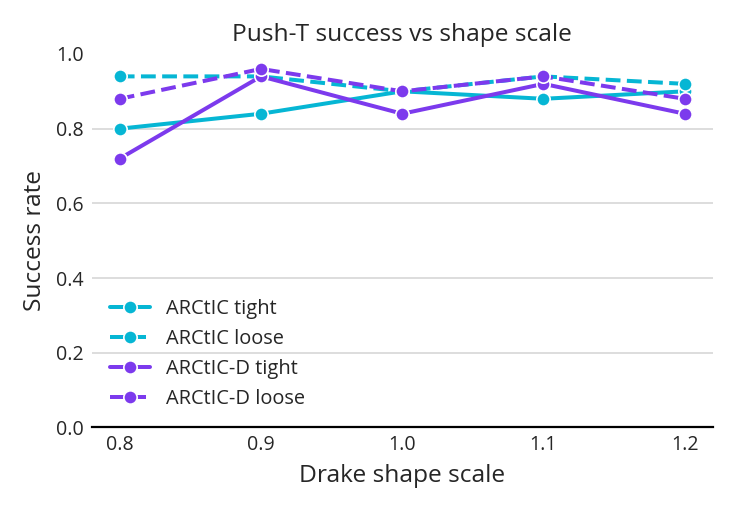
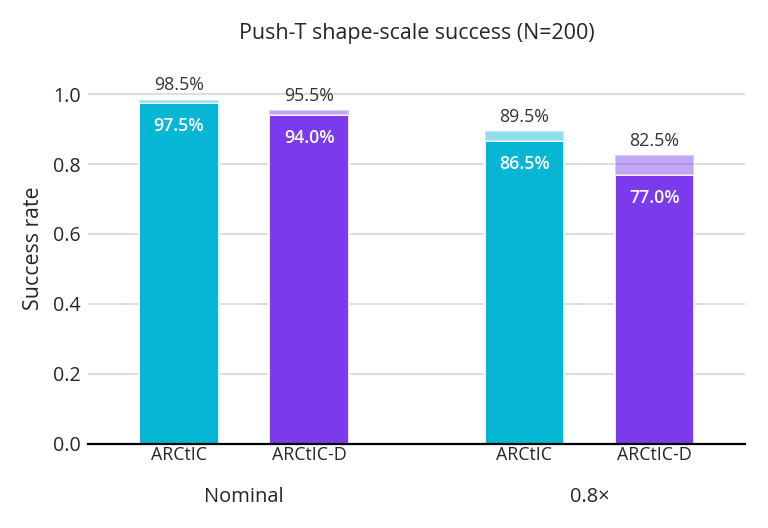

## 1. Center of Mass

My first experiment here was to shift the center of mass along the vertical stem of the "T". I originally did a couple runs that looked promising, where ARCtIC seemd to outperform ARCtIC-D:

I generated new configs and tried to reproduce and I got:

Where the difference kind of just disappears. The time-to-goal is also not signficant.

## 2. Changing the Shape

My second experiment is about changing the shape of the "T", but by randomizing the stem. Here is what draws from the uncertainty distribution look like:

I tested this distribution on the nominal and version of the experiment where the stem is shifted 2 cm in either direction. Here are the results:

As you can see, not much difference

## 3. Shape Scale

Finally, here are some shape scale results. They don't look promising at $N=50$, as there is way too much noise:

But, they almost look promising in a later $N=200$ run I did of just the nominal and 0.8x version:

Note that 86% to 77% is significant at $N=200$.