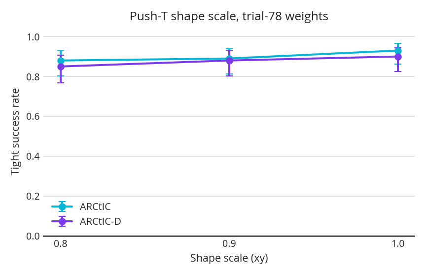
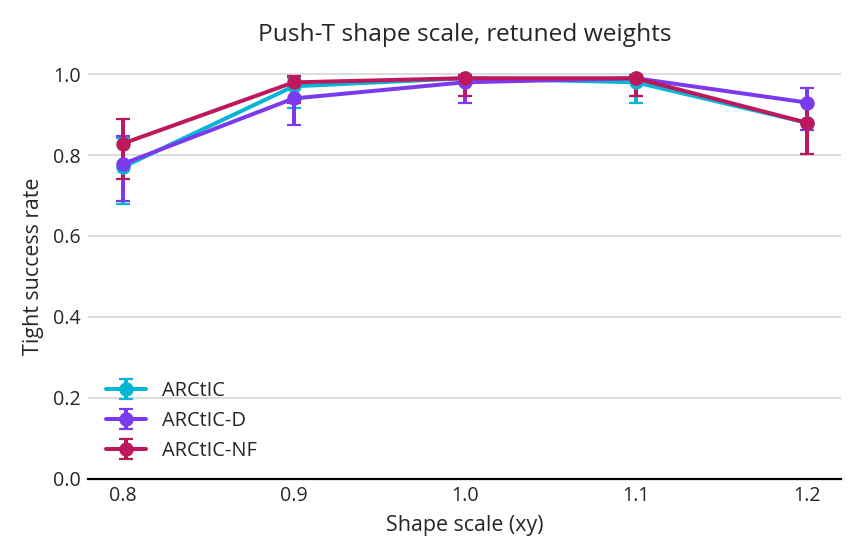
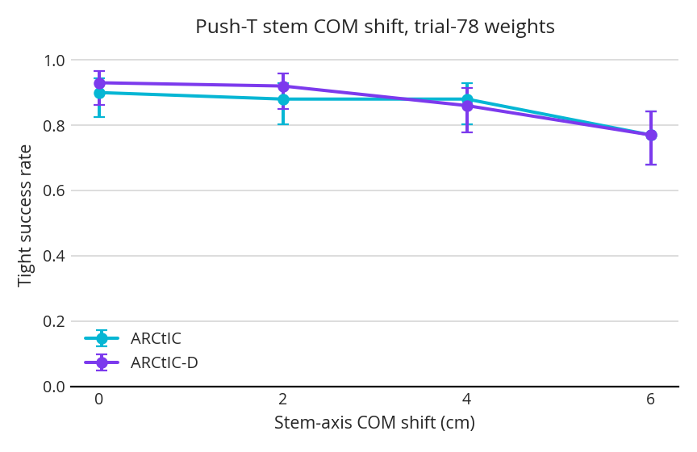
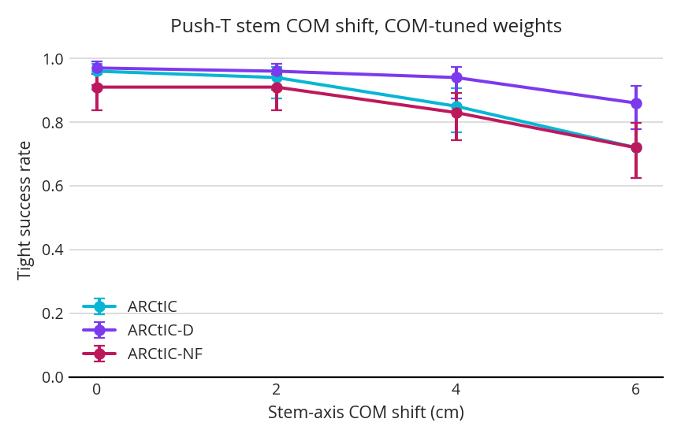

## 1. Some Figures

## 2. Current thoughts

I still think that without a real mechanistic explanation of how we would expect an uncertainty-aware version to perform differently or better in certain pushes, we should not have much confidence in getting results on this task.

