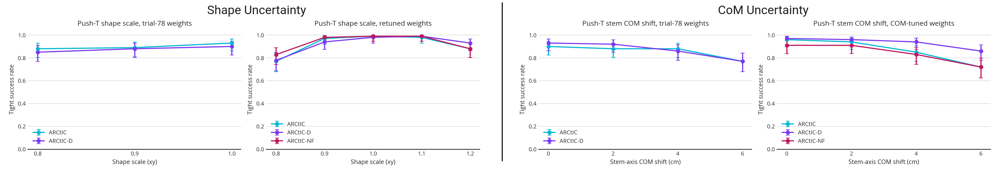
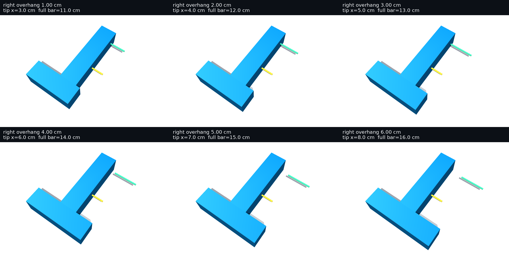
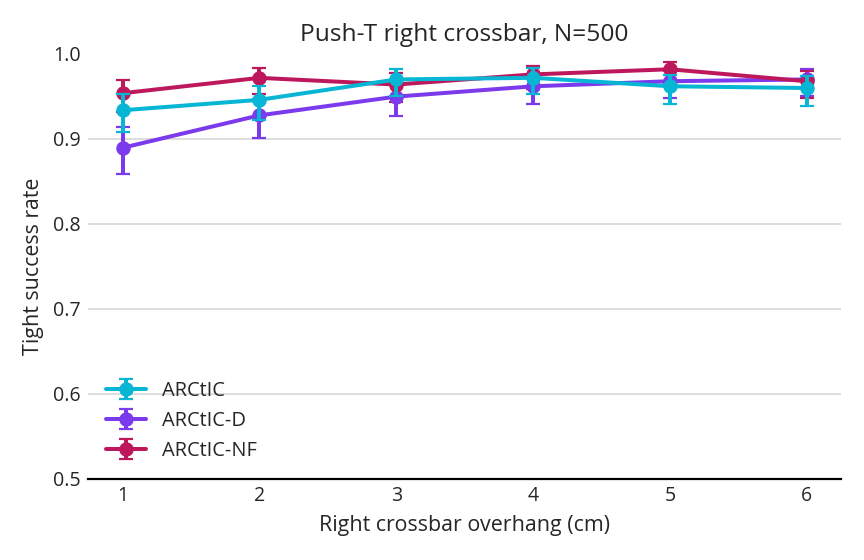
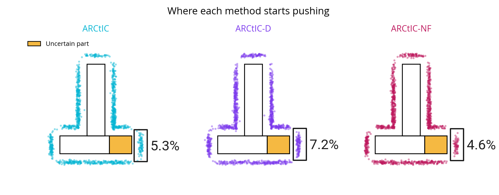

Last week, I had some lackluster results:

This week, I tried to experiment with a different uncertainty type:

Here are the results from 500 trials:

And here is a heatmap of where each method pushed from, showing how incorporating uncertainty changes certain decisions:

