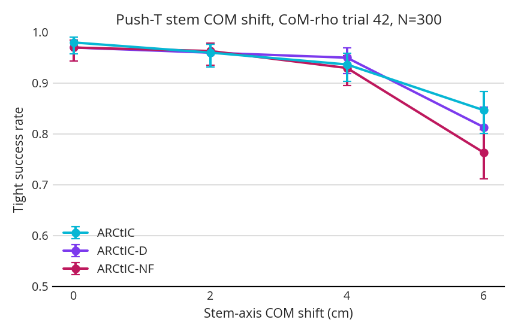
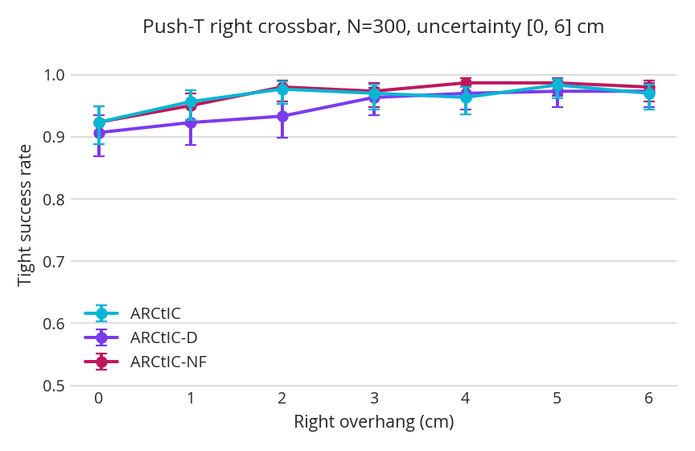
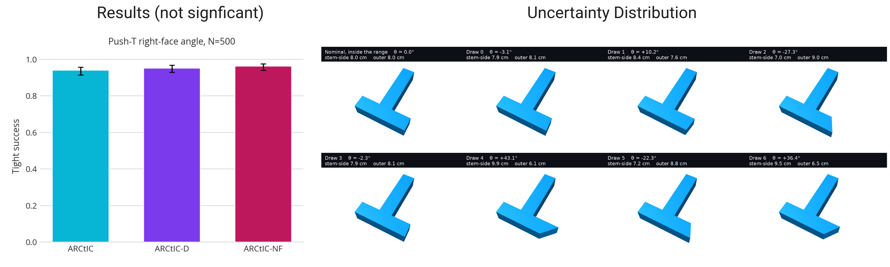

## 1. Results from the Last Week:

Here are the results from running stuff the past week:

I tried a more exotic shape alterations, and got this (non-)result:

## 2. Other stuff

### 2.1. Classes Next Semester

The main class that I am considering taking is:

> **CIS 7000: Designing Multi-Agent Systems** 
>
> This seminar addresses the design of multi-agent LLM systems: when does splitting a task across coordinated agents beat a single well-prompted, compute-matched call, and how do you factor the task in the first place? Today, decisions like task decomposition, agent roles, and communication topology are made largely by intuition. We'll read the current multi-agent-systems literature — both theory and deployed systems — then turn to organizational theory, which has spent sixty years solving the analogous coordination problem for human organizations, treating its results as testable hypotheses about agent architecture. We close by examining where the analogy breaks: AI agents' near-zero cost to instantiate or discard has no human-hiring equivalent, and may push multi-agent systems toward structures transaction costs never allowed in human firms. Final team projects test these ideas in depth.

I think learning more about "agentic" systems and applying to robotics is a current trend that I think will be a lasting one in robotics (at least in some form), and I think this class may help give me a better understanding of the current research in agentic systems.

But I there are also others that look interesting like ESE 6740, MEAM 6250, STAT 5330, but I would probably rather just audit those ones. I think I only have 2 more required classes after this semester for CIS, but they have sort of strict requirements that I don't think any of these classes meet.

### 2.2. Class Project

Proving a bound like:
$$ J(Q) \leq \hat J(Q) + C_1 \sqrt{\frac{\hat J(Q)\left( D_{KL}(Q \| P) + \ln \frac{\nu}{\delta}\right)}{NT}} + C_2 \frac{D_{KL}(Q \| P) + \ln \frac{\nu}{\delta}}{NT} $$
for imitation learning from a Lipschitz, exponentially stable expert. I know we mentioned RSS, but I worry that this might not be the exact right venue.
